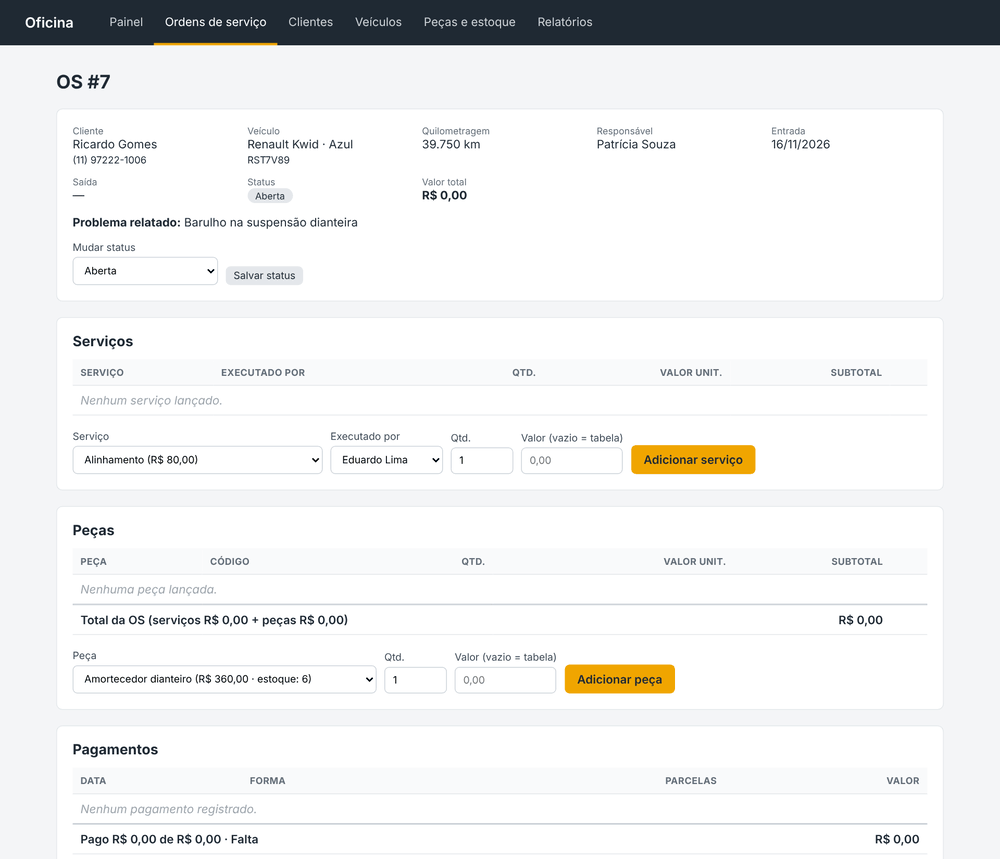
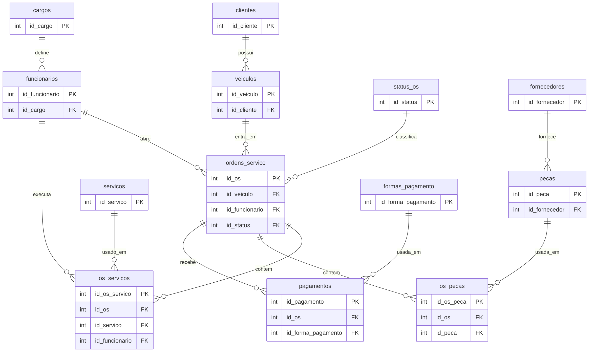
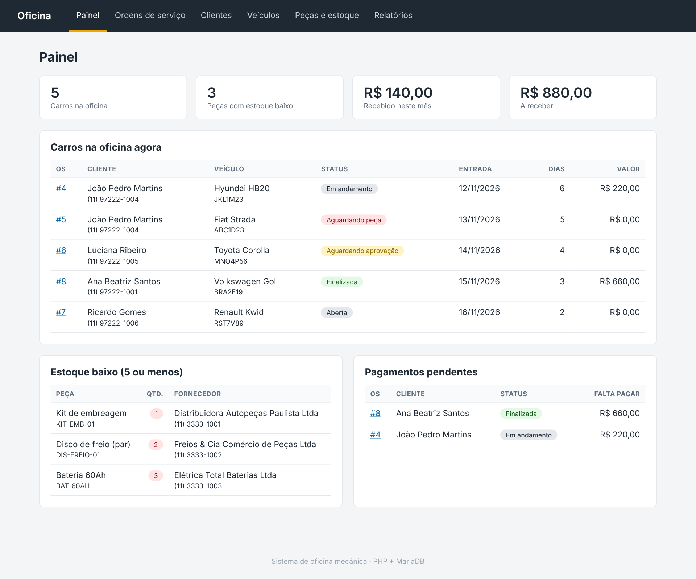
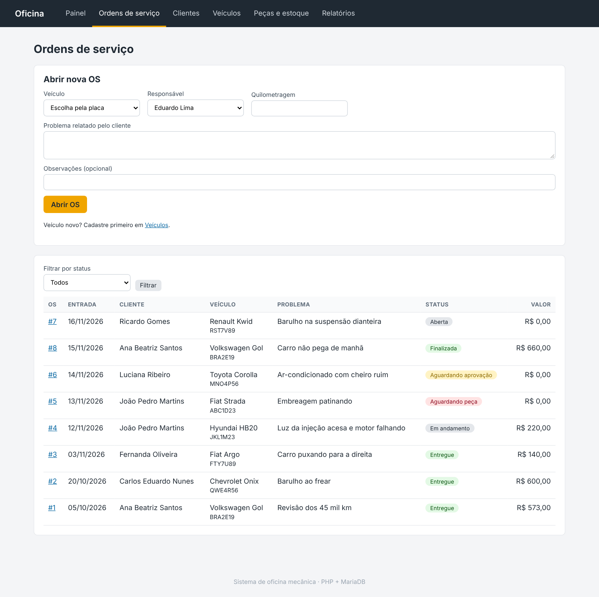
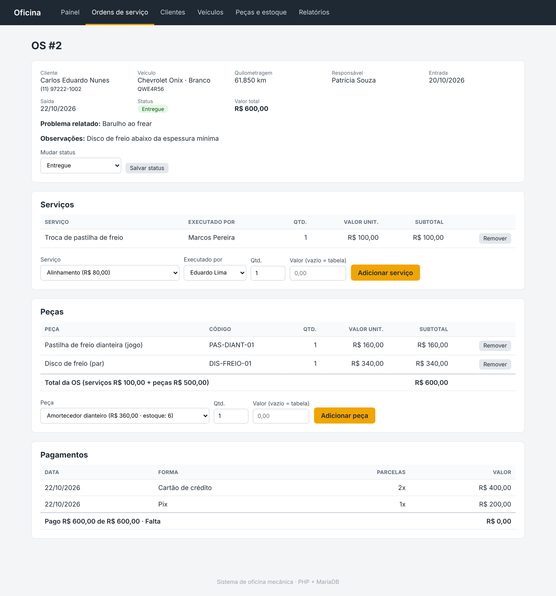
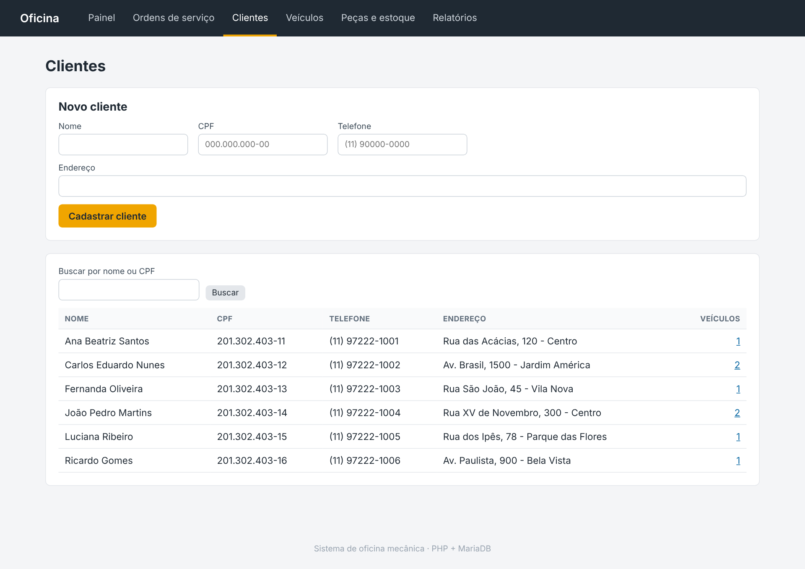
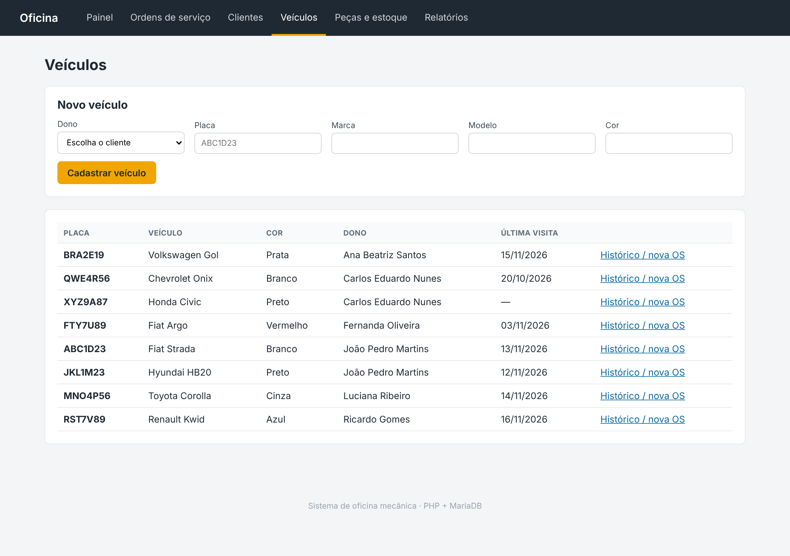
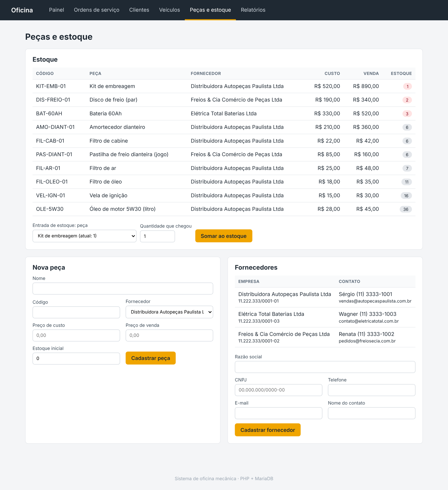
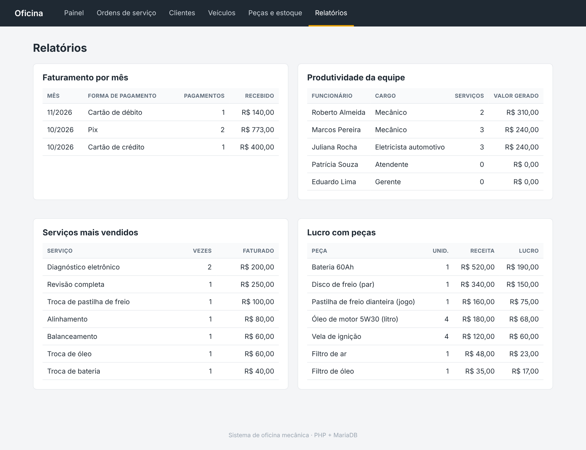

# Sistema de Gestão para Oficina Mecânica

Sistema web para controlar o dia a dia de uma oficina: clientes, veículos, ordens de serviço, peças em estoque, pagamentos e relatórios. O banco de dados relacional foi modelado do zero em **MariaDB**, e a interface foi feita em **PHP**.

*Na demonstração, uma OS recebe um serviço e duas peças. O valor total é recalculado e o estoque é baixado pelo próprio banco de dados, sem nenhuma conta feita no PHP.*

---

## Destaques

- **13 tabelas** normalizadas, com chaves primárias e estrangeiras
- **11 triggers** que mantêm o estoque e o valor das OS sempre corretos
- **6 views** com as consultas mais usadas pela oficina
- **Regras de integridade** no banco: estoque nunca negativo, CPF, CNPJ, placa e código de peça únicos, valores de pagamento positivos
- **Sistema web completo**: painel, ordens de serviço, cadastros, estoque e relatórios

## Tecnologias

| Camada | Tecnologia |
|---|---|
| Banco de dados | MariaDB (compatível com MySQL) |
| Back-end | PHP 8 com PDO e consultas preparadas |
| Front-end | HTML e CSS |
| Ambiente | XAMPP (Apache + MariaDB) |

---

## Modelagem do banco

| Tabela | Função |
|---|---|
| `clientes` | Donos dos veículos |
| `veiculos` | Carros dos clientes (um cliente pode ter vários) |
| `cargos` | Funções da equipe |
| `funcionarios` | Equipe da oficina, cada um com um cargo |
| `status_os` | Etapas de uma OS: aberta, em orçamento, aguardando peça, em andamento, finalizada, entregue, cancelada |
| `ordens_servico` | Cada entrada de um veículo na oficina |
| `servicos` | Catálogo de serviços com preço e tempo estimado |
| `os_servicos` | Serviços feitos em cada OS e quem executou (muitos-para-muitos) |
| `fornecedores` | Empresas que fornecem as peças |
| `pecas` | Catálogo de peças com custo, preço de venda e estoque |
| `os_pecas` | Peças usadas em cada OS (muitos-para-muitos) |
| `formas_pagamento` | Dinheiro, Pix, cartões e boleto |
| `pagamentos` | Pagamentos de cada OS, que pode ser paga em partes |

**Decisões de modelagem**

- O preço cobrado fica gravado em `os_servicos` e `os_pecas`. Assim, se o preço do catálogo mudar, as OS antigas continuam com o valor que o cliente realmente pagou.
- A OS não guarda o cliente: ela aponta para o veículo, e o veículo aponta para o dono. Isso evita guardar a mesma informação em dois lugares.
- Status, cargos e formas de pagamento ficam em tabelas próprias, e não como texto livre. Isso padroniza os dados e facilita os filtros.

## Automatizações no banco (triggers)

| O que acontece | O que o banco faz sozinho |
|---|---|
| Uma peça é lançada numa OS | Baixa a quantidade do estoque |
| Uma peça é removida da OS | Devolve a quantidade ao estoque |
| Tentativa de usar mais peças do que existem | Recusa a operação |
| Um serviço ou peça entra, muda ou sai | Recalcula o valor total da OS |
| O preço não é informado | Usa o preço do catálogo |

## Consultas salvas (views)

| View | Responde |
|---|---|
| OS abertas | Quais carros estão na oficina agora, e há quantos dias? |
| Histórico do veículo | O que já foi feito neste carro, pela placa? |
| Estoque baixo | Quais peças precisam ser compradas, e de qual fornecedor? |
| Saldo das OS | Quem ainda deve dinheiro para a oficina? |
| Faturamento mensal | Quanto entrou por mês, separado por forma de pagamento? |
| Produtividade | Quantos serviços cada funcionário fez, e quanto gerou? |

---

## Telas

### Painel
Resumo do dia: carros na oficina, peças acabando, pagamentos pendentes e o total recebido no mês.

### Ordens de serviço
Abertura de OS e lista com filtro por status.

### Detalhe da OS
Serviços, peças, total, mudança de status e registro de pagamentos, com mais de uma forma de pagamento na mesma OS.

### Clientes e veículos
Cadastro com busca e o histórico de cada veículo.

### Peças e estoque
Catálogo de peças, entrada de mercadoria e fornecedores. Peças com 5 unidades ou menos aparecem em destaque.

### Relatórios
Faturamento por mês, produtividade da equipe, serviços mais vendidos e lucro com peças.

---

## Sobre o código

Este repositório é uma vitrine do projeto. O código-fonte (scripts SQL e sistema PHP) fica em um repositório privado, e o acesso pode ser liberado mediante solicitação.

Todos os dados que aparecem nas imagens (pessoas, empresas, CPFs, CNPJs e placas) são fictícios.

---

Projeto desenvolvido como trabalho acadêmico de Banco de Dados.
